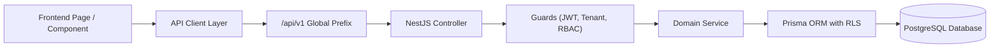

# MyBill History — Frontend to Backend API Module Map

**Date:** 2026-10-27  
**Version:** 1.0.0  
**Architectural Scope:** Complete Frontend Route → API Client → Backend Controller → Service Layer → Database Domain Mapping

---

## 1. Overview
This document defines the authoritative end-to-end architecture mapping for **MyBill History**. Every user-facing screen, navigation item, and user action is mapped to its corresponding standardized backend API endpoint, controller handler, underlying domain service, and Prisma database models.

---

## 2. Architecture Layers

---

## 3. Module-by-Module Mapping

### A. Dashboard Module
| Frontend Page | User Action / Widget | Frontend API Call | Standardized Backend Route | Controller & Handler | Service Method | Database Entities |
|---|---|---|---|---|---|---|
| `/` & `/dashboard` | Financial KPI Cards (To Collect, To Pay, Cash/Bank) | `GET /reports/financial-summary` | `GET /api/v1/dashboard/summary` & `GET /api/v1/reports/financial-summary` | `ReportsController.getFinancialSummary` | `ReportsService.getFinancialSummary` | `SalesInvoice`, `PurchaseInvoice`, `Voucher`, `LedgerAccount` |
| `/` & `/dashboard` | Recent Expenses Widget | `GET /expenses` | `GET /api/v1/expenses` | `ExpensesController.listExpenses` | `ExpensesService.listExpenses` | `Voucher`, `LedgerAccount` |
| `/` & `/dashboard` | Active Bank & Cash Accounts Widget | `GET /bank-accounts` | `GET /api/v1/bank-accounts` & `GET /api/v1/banking/accounts` | `BankAccountsController.listBankAccounts` | `BankAccountsService.listBankAccounts` | `LedgerAccount` (`isBank`, `isCash`) |
| `/` & `/dashboard` | Recent Sales Widget | `GET /invoices` | `GET /api/v1/sales/invoices` & `GET /api/v1/invoices` | `InvoicesController.findAll` | `InvoicesService.findAll` | `SalesInvoice`, `Party` |
| `/` & `/dashboard` | Recent Purchases Widget | `GET /purchases` | `GET /api/v1/purchases/invoices` & `GET /api/v1/purchases` | `PurchasesController.findAll` | `PurchasesService.findAll` | `PurchaseInvoice`, `Party` |

---

### B. Masters Module
| Frontend Page | User Action / Screen | Frontend API Call | Standardized Backend Route | Controller & Handler | Service Method | Database Entities |
|---|---|---|---|---|---|---|
| `/masters/parties` | List parties / search / filter | `GET /parties` | `GET /api/v1/masters/parties` & `/api/v1/parties` | `PartiesController.findAll` | `PartiesService.findAll` | `Party`, `PartyContact` |
| `/masters/parties` | Create new customer / supplier | `POST /parties` | `POST /api/v1/masters/parties` & `/api/v1/parties` | `PartiesController.create` | `PartiesService.create` | `Party` |
| `/masters/parties` | View party details & balances | `GET /parties/:id` | `GET /api/v1/masters/parties/:id` | `PartiesController.findOne` | `PartiesService.findOne` | `Party`, `SalesInvoice`, `Voucher` |
| `/masters/parties` | Edit / update party | `PUT /parties/:id` | `PUT /api/v1/masters/parties/:id` | `PartiesController.update` | `PartiesService.update` | `Party` |
| `/masters/parties` | Delete / deactivate party | `DELETE /parties/:id` | `DELETE /api/v1/masters/parties/:id` | `PartiesController.remove` | `PartiesService.remove` | `Party` |
| `/masters/parties` | Bulk delete parties | `POST /parties/bulk-delete` | `POST /api/v1/masters/parties/bulk-delete` | `PartiesController.bulkDelete` | `PartiesService.bulkDelete` | `Party` |
| `/masters/parties` | Statutory GSTIN search & verification | `GET /parties/lookup/gstin/:gstin` | `GET /api/v1/gst/verify-gstin` | `GstController.verifyGstin` | `GstVerificationService.verifyGstin` | External GSTIN Provider / Cache |
| `/masters/items` | List inventory items / filter | `GET /items` | `GET /api/v1/masters/items` & `/api/v1/items` | `ItemsController.findAll` | `ItemsService.findAll` | `Item`, `ItemCategory`, `UnitOfMeasure` |
| `/masters/items` | Create item / product | `POST /items` | `POST /api/v1/masters/items` & `/api/v1/items` | `ItemsController.create` | `ItemsService.create` | `Item` |
| `/masters/items` | View item details & stock | `GET /items/:id` | `GET /api/v1/masters/items/:id` | `ItemsController.findOne` | `ItemsService.findOne` | `Item`, `StockTransaction` |
| `/masters/items` | Edit / update item | `PUT /items/:id` | `PUT /api/v1/masters/items/:id` | `ItemsController.update` | `ItemsService.update` | `Item` |
| `/masters/items` | Delete item | `DELETE /items/:id` | `DELETE /api/v1/masters/items/:id` | `ItemsController.delete` | `ItemsService.delete` | `Item` |
| `/masters/items` | Bulk delete items | `POST /items/bulk-delete` | `POST /api/v1/masters/items/bulk-delete` | `ItemsController.bulkDelete` | `ItemsService.bulkDelete` | `Item` |
| `/masters/items` | Stock adjustment | `POST /items/:id/adjust-stock` | `POST /api/v1/masters/items/:id/adjust-stock` | `ItemsController.adjustStock` | `ItemsService.adjustStock` | `StockTransaction`, `Item` |
| `/masters/categories` | List product categories | `GET /categories` | `GET /api/v1/masters/categories` & `/api/v1/categories` | `CategoriesController.findAll` | `CategoriesService.findAll` | `ItemCategory` |
| `/masters/categories` | Create category | `POST /categories` | `POST /api/v1/masters/categories` | `CategoriesController.create` | `CategoriesService.create` | `ItemCategory` |
| `/masters/categories` | Update category | `PUT /categories/:id` | `PUT /api/v1/masters/categories/:id` | `CategoriesController.update` | `CategoriesService.update` | `ItemCategory` |
| `/masters/categories` | Delete category | `DELETE /categories/:id` | `DELETE /api/v1/masters/categories/:id` | `CategoriesController.delete` | `CategoriesService.delete` | `ItemCategory` |
| `/masters/units` | List units of measure | `GET /units` | `GET /api/v1/masters/units` & `/api/v1/units` | `UnitsController.findAll` | `UnitsService.findAll` | `UnitOfMeasure` |
| `/masters/units` | Create unit | `POST /units` | `POST /api/v1/masters/units` | `UnitsController.create` | `UnitsService.create` | `UnitOfMeasure` |
| `/masters/units` | Update unit | `PUT /units/:id` | `PUT /api/v1/masters/units/:id` | `UnitsController.update` | `UnitsService.update` | `UnitOfMeasure` |
| `/masters/units` | Delete unit | `DELETE /units/:id` | `DELETE /api/v1/masters/units/:id` | `UnitsController.delete` | `UnitsService.delete` | `UnitOfMeasure` |
| `/masters/hsn` | List & search HSN / SAC codes | `GET /hsn` | `GET /api/v1/masters/hsn` & `/api/v1/hsn` | `HsnController.findAll` | `HsnService.findAll` | `HsnCode` |
| `/masters/hsn` | Create HSN entry | `POST /hsn` | `POST /api/v1/masters/hsn` | `HsnController.create` | `HsnService.create` | `HsnCode` |
| `/masters/hsn` | Update HSN rate / description | `PUT /hsn/:id` | `PUT /api/v1/masters/hsn/:id` | `HsnController.update` | `HsnService.update` | `HsnCode` |
| `/masters/hsn` | Toggle active status | `PATCH /hsn/:id/status` | `PATCH /api/v1/masters/hsn/:id/status` | `HsnController.toggleStatus` | `HsnService.toggleStatus` | `HsnCode` |
| `/masters/warehouses` | List warehouses | `GET /warehouses` | `GET /api/v1/masters/warehouses` & `/api/v1/warehouses` | `WarehousesController.getWarehouses` | `TenantsService.getWarehouses` | `Warehouse` |
| `/masters/warehouses` | Create warehouse | `POST /warehouses` | `POST /api/v1/masters/warehouses` | `WarehousesController.createWarehouse` | `TenantsService.createWarehouse` | `Warehouse` |
| `/masters/warehouses` | Update warehouse | `PUT /warehouses/:id` | `PUT /api/v1/masters/warehouses/:id` | `WarehousesController.updateWarehouse` | `TenantsService.updateWarehouse` | `Warehouse` |
| `/masters/warehouses` | Delete warehouse | `DELETE /warehouses/:id` | `DELETE /api/v1/masters/warehouses/:id` | `WarehousesController.deleteWarehouse` | `TenantsService.deleteWarehouse` | `Warehouse` |

---

### C. Sales Module
| Frontend Page | User Action / Screen | Frontend API Call | Standardized Backend Route | Controller & Handler | Service Method | Database Entities |
|---|---|---|---|---|---|---|
| `/sales/invoices` | List invoices / search / filter | `GET /invoices/sales` | `GET /api/v1/sales/invoices` & `/api/v1/invoices/sales` | `InvoicesController.findAll` | `InvoicesService.findAll` | `SalesInvoice`, `Party` |
| `/sales/invoices/new` | Generate next invoice number | `GET /invoices/sales/next-number` | `GET /api/v1/sales/invoices/next-number` | `InvoicesController.getNextInvoiceNumber` | `InvoicesService.getNextNumber` | `InvoiceSequence` |
| `/sales/invoices/new` | Create draft or tax invoice | `POST /invoices/sales` | `POST /api/v1/sales/invoices` | `InvoicesController.create` | `InvoicesService.create` | `SalesInvoice`, `SalesInvoiceItem`, `StockTransaction`, `JournalEntry` |
| `/sales/invoices/:id` | View invoice details | `GET /invoices/sales/:id` | `GET /api/v1/sales/invoices/:id` | `InvoicesController.findOne` | `InvoicesService.findOne` | `SalesInvoice`, `SalesInvoiceItem` |
| `/sales/invoices/:id/edit`| Update invoice | `PUT /invoices/sales/:id` | `PUT /api/v1/sales/invoices/:id` | `InvoicesController.update` | `InvoicesService.update` | `SalesInvoice`, `SalesInvoiceItem` |
| `/sales/invoices` | Issue draft invoice | `POST /invoices/sales/:id/issue` | `POST /api/v1/sales/invoices/:id/issue` | `InvoicesController.issueInvoice` | `InvoicesService.issue` | `SalesInvoice`, `StockTransaction`, `JournalEntry` |
| `/sales/invoices` | Cancel tax invoice | `POST /invoices/sales/:id/cancel` | `POST /api/v1/sales/invoices/:id/cancel` | `InvoicesController.cancel` | `InvoicesService.cancel` | `SalesInvoice`, `StockTransaction` (reversal), `JournalEntry` |
| `/sales/invoices` | Record bill-by-bill payment | `POST /invoices/sales/:id/payments` | `POST /api/v1/sales/invoices/:id/payments` | `InvoicesController.recordPayment` | `InvoicesService.recordPayment` | `PaymentAllocation`, `Voucher`, `JournalEntry` |
| `/sales/pos` | Offline POS checkout sync | `POST /invoices/pos-checkout` | `POST /api/v1/sales/pos-checkout` | `InvoicesController.posCheckout` | `InvoicesService.posCheckout` | `SalesInvoice`, `PosSession`, `StockTransaction` |
| `/sales/credit-note` | List credit notes (sales returns) | `GET /sales-returns` | `GET /api/v1/sales/credit-notes` & `/api/v1/sales-returns` | `SalesReturnsController.findAll` | `SalesReturnsService.findAll` | `SalesReturn`, `Party` |
| `/sales/credit-note/new`| Create credit note | `POST /sales-returns` | `POST /api/v1/sales/credit-notes` | `SalesReturnsController.create` | `SalesReturnsService.create` | `SalesReturn`, `StockTransaction`, `JournalEntry` |
| `/sales/credit-note/:id`| View credit note | `GET /sales-returns/:id` | `GET /api/v1/sales/credit-notes/:id` | `SalesReturnsController.findOne` | `SalesReturnsService.findOne` | `SalesReturn`, `SalesReturnItem` |
| `/sales/credit-note/:id`| Delete / reverse credit note | `DELETE /sales-returns/:id` | `DELETE /api/v1/sales/credit-notes/:id` | `SalesReturnsController.delete` | `SalesReturnsService.delete` | `SalesReturn` |
| `/sales/payment-in` | List receipt vouchers | `GET /vouchers/receipts` | `GET /api/v1/sales/payment-in` & `/api/v1/vouchers/receipts` | `VouchersController.listReceipts` | `VouchersService.listReceipts` | `Voucher`, `Party`, `LedgerAccount` |
| `/sales/payment-in/new` | Record customer receipt | `POST /vouchers/receipt` | `POST /api/v1/sales/payment-in` & `/api/v1/vouchers/receipt` | `VouchersController.createReceipt` | `VouchersService.createReceipt` | `Voucher`, `JournalEntry`, `PaymentAllocation` |
| `/sales/delivery-challan`| List delivery challans | `GET /distribution/challans` | `GET /api/v1/sales/challans` & `/api/v1/distribution/challans` | `DeliveryChallansController.findAll` | `DeliveryChallansService.findAll` | `DeliveryChallan`, `Party` |
| `/sales/delivery-challan/new`| Create delivery challan | `POST /distribution/challans` | `POST /api/v1/sales/challans` | `DeliveryChallansController.create` | `DeliveryChallansService.create` | `DeliveryChallan`, `StockTransaction` |
| `/sales/delivery-challan/:id`| Close / Complete challan | `POST /distribution/challans/:id/close` | `POST /api/v1/sales/challans/:id/close` | `DeliveryChallansController.close` | `DeliveryChallansService.close` | `DeliveryChallan` |
| `/sales/delivery-challan/:id`| Cancel challan | `POST /distribution/challans/:id/cancel` | `POST /api/v1/sales/challans/:id/cancel` | `DeliveryChallansController.cancel` | `DeliveryChallansService.cancel` | `DeliveryChallan`, `StockTransaction` |

---

### D. Purchases Module
| Frontend Page | User Action / Screen | Frontend API Call | Standardized Backend Route | Controller & Handler | Service Method | Database Entities |
|---|---|---|---|---|---|---|
| `/purchases` | List purchase bills | `GET /purchases` | `GET /api/v1/purchases/invoices` & `/api/v1/purchases` | `PurchasesController.findAll` | `PurchasesService.findAll` | `PurchaseInvoice`, `Party` |
| `/purchases/new` | Create purchase bill | `POST /purchases` | `POST /api/v1/purchases/invoices` & `/api/v1/purchases` | `PurchasesController.create` | `PurchasesService.create` | `PurchaseInvoice`, `PurchaseInvoiceItem`, `StockTransaction`, `JournalEntry` |
| `/purchases/:id` | View purchase bill | `GET /purchases/:id` | `GET /api/v1/purchases/invoices/:id` | `PurchasesController.findOne` | `PurchasesService.findOne` | `PurchaseInvoice`, `PurchaseInvoiceItem` |
| `/purchases/:id` | Delete / cancel purchase | `DELETE /purchases/:id` | `DELETE /api/v1/purchases/invoices/:id` | `PurchasesController.delete` | `PurchasesService.delete` | `PurchaseInvoice`, `StockTransaction`, `JournalEntry` |
| `/purchases/:id/payments` | Record supplier payment | `POST /purchases/:id/payments` | `POST /api/v1/purchases/invoices/:id/payments` | `PurchasesController.recordPayment` | `PurchasesService.recordPayment` | `PaymentAllocation`, `Voucher`, `JournalEntry` |
| `/purchases/debit-note` | List debit notes (purchase returns) | `GET /purchase-returns` | `GET /api/v1/purchases/debit-notes` & `/api/v1/purchase-returns` | `PurchaseReturnsController.findAll` | `PurchaseReturnsService.findAll` | `PurchaseReturn`, `Party` |
| `/purchases/debit-note/new`| Create debit note | `POST /purchase-returns` | `POST /api/v1/purchases/debit-notes` | `PurchaseReturnsController.create` | `PurchaseReturnsService.create` | `PurchaseReturn`, `StockTransaction`, `JournalEntry` |
| `/purchases/debit-note/:id`| View debit note | `GET /purchase-returns/:id` | `GET /api/v1/purchases/debit-notes/:id` | `PurchaseReturnsController.findOne` | `PurchaseReturnsService.findOne` | `PurchaseReturn`, `PurchaseReturnItem` |
| `/purchases/payment-out` | List supplier payment vouchers | `GET /vouchers/payments-out` | `GET /api/v1/purchases/payment-out` & `/api/v1/vouchers/payments-out` | `VouchersController.listPaymentsOut` | `VouchersService.listPaymentsOut` | `Voucher`, `Party`, `LedgerAccount` |
| `/purchases/payment-out/new`| Record payment out | `POST /vouchers/payment-out` | `POST /api/v1/purchases/payment-out` | `VouchersController.createPaymentOut` | `VouchersService.createPaymentOut` | `Voucher`, `JournalEntry`, `PaymentAllocation` |
| `/purchases/scan` | Upload invoice for OCR parsing | `POST /purchases/scans/upload` | `POST /api/v1/purchases/scans/upload` | `PurchaseScansController.uploadScan` | `PurchaseScansService.processScan` | `PurchaseScan`, Google Gemini Vision / OCR |
| `/purchases/scan` | Confirm parsed OCR bill | `POST /purchases/scans/:id/confirm` | `POST /api/v1/purchases/scans/:id/confirm` | `PurchaseScansController.confirmScan` | `PurchaseScansService.confirmScan` | `PurchaseScan`, `PurchaseInvoice` |

---

### E. Inventory & Distribution Module
| Frontend Page | User Action / Screen | Frontend API Call | Standardized Backend Route | Controller & Handler | Service Method | Database Entities |
|---|---|---|---|---|---|---|
| `/inventory/stock` | Stock valuation & on-hand inventory | `GET /items` | `GET /api/v1/inventory/stock` & `/api/v1/masters/items` | `ItemsController.findAll` | `ItemsService.findAll` | `Item`, `StockTransaction` |
| `/inventory/movements` | Stock transaction audit ledger | `GET /invoices/stock/transactions` | `GET /api/v1/inventory/stock-movements` & `/api/v1/invoices/stock/transactions` | `InvoicesController.getStockMovements` | `InvoicesService.getStockMovements` | `StockTransaction`, `Item`, `Warehouse` |
| `/inventory/transfers` | List inter-branch / warehouse transfers | `GET /distribution/transfers` | `GET /api/v1/inventory/transfers` & `/api/v1/distribution/transfers` | `StockTransfersController.findAll` | `StockTransfersService.findAll` | `StockTransfer`, `Warehouse` |
| `/inventory/transfers/new`| Dispatch stock transfer | `POST /distribution/transfers` | `POST /api/v1/inventory/transfers` | `StockTransfersController.create` | `StockTransfersService.create` | `StockTransfer`, `StockTransaction` |
| `/inventory/transfers/:id`| Receive stock transfer | `POST /distribution/transfers/:id/receive` | `POST /api/v1/inventory/transfers/:id/receive` | `StockTransfersController.receive` | `StockTransfersService.receive` | `StockTransfer`, `StockTransaction` |
| `/inventory/reconciliation`| Stock ledger vs GL reconciliation | `GET /reconciliation/stock-gl` | `GET /api/v1/inventory/reconciliation/stock-gl` & `/api/v1/reconciliation/stock-gl` | `InventoryReconciliationController.getStockGlReconciliation` | `InventoryReconciliationService.reconcile` | `StockTransaction`, `JournalEntry` |
| `/masters/batches` | List item batch numbers & expiries | `GET /batches` | `GET /api/v1/inventory/batches` & `/api/v1/batches` | `BatchesController.findAll` | `BatchesService.findAll` | `ItemBatch`, `Item` |

---

### F. Accounting & Finance Module
| Frontend Page | User Action / Screen | Frontend API Call | Standardized Backend Route | Controller & Handler | Service Method | Database Entities |
|---|---|---|---|---|---|---|
| `/accounting/chart-of-accounts` | Seed standard Indian COA | `POST /ledger-groups/seed` | `POST /api/v1/accounting/groups/seed` & `/api/v1/ledger-groups/seed` | `LedgersController.seedCOA` | `LedgersService.seedStandardChartOfAccounts` | `LedgerGroup`, `LedgerAccount` |
| `/accounting/chart-of-accounts` | List account groups | `GET /ledger-groups` | `GET /api/v1/accounting/groups` & `/api/v1/ledger-groups` | `LedgersController.listGroups` | `LedgersService.listGroups` | `LedgerGroup` |
| `/accounting/ledgers` | List general ledger accounts | `GET /ledgers` | `GET /api/v1/accounting/ledgers` & `/api/v1/ledgers` | `LedgersController.listAccounts` | `LedgersService.listAccounts` | `LedgerAccount`, `LedgerGroup` |
| `/accounting/ledgers` | Create ledger account | `POST /ledgers` | `POST /api/v1/accounting/ledgers` | `LedgersController.createAccount` | `LedgersService.createAccount` | `LedgerAccount` |
| `/accounting/ledgers/:id` | View ledger account & balance | `GET /ledgers/:id` | `GET /api/v1/accounting/ledgers/:id` | `LedgersController.getAccount` | `LedgersService.getAccountById` | `LedgerAccount`, `JournalEntry` |
| `/accounting/ledgers/:id` | Update ledger account | `PATCH /ledgers/:id` | `PATCH /api/v1/accounting/ledgers/:id` | `LedgersController.updateAccount` | `LedgersService.updateAccount` | `LedgerAccount` |
| `/accounting/vouchers` | List journal vouchers | `GET /vouchers` | `GET /api/v1/accounting/vouchers` & `/api/v1/vouchers` | `VouchersController.listVouchers` | `VouchersService.listVouchers` | `Voucher`, `JournalEntry` |
| `/accounting/vouchers/new`| Create double-entry voucher | `POST /vouchers` | `POST /api/v1/accounting/vouchers` | `VouchersController.createVoucher` | `VouchersService.createVoucher` | `Voucher`, `JournalEntry` |
| `/accounting/vouchers/:id`| Reverse voucher | `POST /vouchers/:id/reverse` | `POST /api/v1/accounting/vouchers/:id/reverse` | `VouchersController.reverseVoucher` | `VouchersService.reverseVoucher` | `Voucher`, `JournalEntry` |
| `/finance/cash-bank` | List active cash and bank balances | `GET /bank-accounts` | `GET /api/v1/bank-accounts` & `/api/v1/banking/accounts` | `BankAccountsController.listBankAccounts` | `BankAccountsService.listBankAccounts` | `LedgerAccount` (`isBank`, `isCash`) |
| `/finance/expenses` | List company expense vouchers | `GET /expenses` | `GET /api/v1/expenses` | `ExpensesController.listExpenses` | `ExpensesService.listExpenses` | `Voucher`, `LedgerAccount` |
| `/finance/expenses/new`| Record business expense | `POST /vouchers/expense` | `POST /api/v1/expenses` & `/api/v1/vouchers/expense` | `ExpensesController.createExpense` | `ExpensesService.createExpense` | `Voucher`, `JournalEntry` |

---

### G. Reports Module
| Frontend Page | Report Screen | Frontend API Call | Standardized Backend Route | Controller & Handler | Service Method |
|---|---|---|---|---|---|
| `/reports` | Financial KPI Summary | `GET /reports/financial-summary` | `GET /api/v1/dashboard/summary` & `GET /api/v1/reports/financial-summary` | `ReportsController.getFinancialSummary` | `ReportsService.getFinancialSummary` |
| `/reports` | Sales Register / Overview | `GET /reports/sales-register` | `GET /api/v1/dashboard/sales-overview` & `GET /api/v1/reports/sales-register` | `ReportsController.getSalesRegister` | `ReportsService.getSalesRegister` |
| `/reports` | Purchase Register / Overview | `GET /reports/purchase-register` | `GET /api/v1/dashboard/purchase-overview` & `GET /api/v1/reports/purchase-register` | `ReportsController.getPurchaseRegister` | `ReportsService.getPurchaseRegister` |
| `/reports/day-book` | Day Book (Rojmel) | `GET /reports/daybook` | `GET /api/v1/reports/daybook` | `ReportsController.getDaybook` | `ReportsService.getDaybook` |
| `/reports/general-ledger` | General Ledger Account Trail | `GET /reports/general-ledger` | `GET /api/v1/reports/general-ledger` | `ReportsController.getGeneralLedger` | `ReportsService.getGeneralLedger` |
| `/reports` | Trial Balance | `GET /reports/trial-balance` | `GET /api/v1/reports/trial-balance` | `ReportsController.getTrialBalance` | `ReportsService.getTrialBalance` |
| `/reports` | Profit & Loss Statement | `GET /reports/profit-and-loss` | `GET /api/v1/reports/profit-and-loss` | `ReportsController.getProfitAndLoss` | `ReportsService.getProfitAndLoss` |
| `/reports` | Balance Sheet Statement | `GET /reports/balance-sheet` | `GET /api/v1/reports/balance-sheet` | `ReportsController.getBalanceSheet` | `ReportsService.getBalanceSheet` |
| `/reports` | Cash Flow Statement | `GET /reports/cash-flow` | `GET /api/v1/reports/cash-flow` | `ReportsController.getCashFlow` | `ReportsService.getCashFlow` |
| `/reports` | Party Outstanding Balances | `GET /reports/outstanding-balances` | `GET /api/v1/reports/outstanding-balances` | `ReportsController.getOutstandingBalances` | `ReportsService.getOutstandingBalances` |
| `/reports` | Party Aging Analysis | `GET /reports/party-aging` | `GET /api/v1/reports/party-aging` | `ReportsController.getPartyAging` | `ReportsService.getPartyAging` |
| `/reports` | Stock Valuation Summary | `GET /reports/stock-summary` | `GET /api/v1/reports/stock-summary` | `ReportsController.getStockSummary` | `ReportsService.getStockSummary` |
| `/reports` | Stock Movement Audit | `GET /reports/stock-movement` | `GET /api/v1/reports/stock-movement` | `ReportsController.getStockMovement` | `ReportsService.getStockMovement` |
| `/reports` | Low Stock Alert Report | `GET /reports/low-stock-alert` | `GET /api/v1/reports/low-stock-alert` | `ReportsController.getLowStockAlert` | `ReportsService.getLowStockAlert` |
| `/reports/expense-category` | Expense Breakdown by Group | `GET /reports/expense-category-report` | `GET /api/v1/reports/expense-category-report` | `ReportsController.getExpenseCategoryReport` | `ReportsService.getExpenseCategoryReport` |
| `/reports` | Tamper-Evident Audit Trail | `GET /reports/audit-trail` | `GET /api/v1/reports/audit-trail` | `ReportsController.getAuditTrail` | `ReportsService.getAuditTrail` |

---

### H. GST & Tax Module
| Frontend Page | Action / Screen | Frontend API Call | Standardized Backend Route | Controller & Handler | Service Method |
|---|---|---|---|---|---|
| `/gst/gstr-1` | GSTR-1 Outward Supplies Report | `GET /reports/gstr-1` | `GET /api/v1/reports/gstr-1` & `/api/v1/gst/gstr-1` | `ReportsController.getGstr1` | `ReportsService.getGstr1` |
| `/gst/gstr-3b` | GSTR-3B Monthly Return Summary | `GET /reports/gstr-3b` | `GET /api/v1/reports/gstr-3b` & `/api/v1/gst/gstr-3b` | `ReportsController.getGstr3b` | `ReportsService.getGstr3b` |
| `/gst/einvoice` | Generate NIC / IRN e-Invoice | `POST /gst/einvoice/:id/generate` | `POST /api/v1/gst/einvoice/:id/generate` | `GstController.generateEInvoice` | `GstService.generateEInvoice` |
| `/gst/eway` | Generate NIC e-Way Bill | `POST /gst/eway-bills/invoices/:id/generate` | `POST /api/v1/gst/eway-bills/invoices/:id/generate` | `GstController.generateEWayBill` | `GstService.generateEWayBill` |
| `/gst/eway` | Update e-Way Bill Vehicle | `POST /gst/eway-bills/:ewbNumber/vehicle` | `POST /api/v1/gst/eway-bills/:ewbNumber/vehicle` | `GstController.updateVehicle` | `GstService.updateVehicle` |
| `/gst/eway` | Cancel e-Way Bill | `POST /gst/eway-bills/:ewbNumber/cancel` | `POST /api/v1/gst/eway-bills/:ewbNumber/cancel` | `GstController.cancelEWayBill` | `GstService.cancelEWayBill` |
| `/gst/gstr-2b` | Import statutory GSTR-2B JSON | `POST /gst/gstr-2b/imports` | `POST /api/v1/gst/gstr-2b/imports` | `GstController.importGstr2b` | `GstService.importGstr2b` |
| `/gst/gstr-2b` | Run 2B Purchase Reconciliation | `GET /gst/gstr-2b/reconciliations` | `GET /api/v1/gst/gstr-2b/reconciliations` | `GstController.getReconciliations` | `GstService.getReconciliations` |
| `/gst/settings` | Test GST sandbox connection | `POST /gst/integration/sandbox-ping` | `POST /api/v1/gst/integration/sandbox-ping` | `GstController.sandboxPing` | `GstService.pingSandbox` |

---

### I. Settings & Administration Module
| Frontend Page | Action / Screen | Frontend API Call | Standardized Backend Route | Controller & Handler | Service Method |
|---|---|---|---|---|---|
| `/settings` | Get company profile & settings | `GET /tenants/company` | `GET /api/v1/tenants/company` & `/api/v1/settings/company` | `TenantsController.getCurrentCompany` | `TenantsService.getCurrentCompany` |
| `/settings` | Update company profile | `PATCH /tenants/company` | `PATCH /api/v1/tenants/company` | `TenantsController.updateCurrentCompany` | `TenantsService.updateCurrentCompany` |
| `/settings` | List company branches | `GET /tenants/branches` | `GET /api/v1/tenants/branches` | `TenantsController.getBranches` | `TenantsService.getBranches` |
| `/settings` | Create branch | `POST /tenants/branches` | `POST /api/v1/tenants/branches` | `TenantsController.createBranch` | `TenantsService.createBranch` |
| `/settings` | List financial years | `GET /tenants/financial-years` | `GET /api/v1/tenants/financial-years` | `TenantsController.getFinancialYears` | `TenantsService.getFinancialYears` |
| `/app/settings/user-management` | List tenant users | `GET /tenants/users` | `GET /api/v1/tenants/users` | `TenantsController.getUsers` | `TenantsService.getUsers` |
| `/app/settings/user-management` | Invite / create user | `POST /tenants/users` | `POST /api/v1/tenants/users` | `TenantsController.createUser` | `TenantsService.createUser` |
| `/app/settings/user-management` | Update user role / permissions | `PATCH /tenants/users/:id` | `PATCH /api/v1/tenants/users/:id` | `TenantsController.updateUser` | `TenantsService.updateUser` |
| `/app/settings/user-management` | Deactivate / remove user | `DELETE /tenants/users/:id` | `DELETE /api/v1/tenants/users/:id` | `TenantsController.deleteUser` | `TenantsService.deleteUser` |
| `/login` | User login | `POST /auth/login` | `POST /api/v1/auth/login` | `AuthController.login` | `AuthService.login` |
| `/login` | Tenant registration | `POST /auth/register` | `POST /api/v1/auth/register` | `AuthController.register` | `AuthService.register` |
| Global Header | Switch company context | `POST /auth/switch-context` | `POST /api/v1/auth/switch-context` | `AuthController.switchContext` | `AuthService.switchCompanyContext` |
| Global Header | Live token / session status | `GET /auth/live-status` | `GET /api/v1/auth/live-status` | `AuthController.getLiveStatus` | `AuthService.getLiveStatus` |
